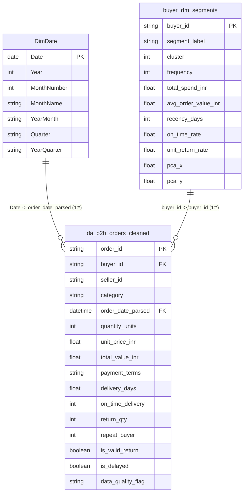

# TradeSight Export Analytics — Power BI Data Model & Publishing Guide (V1)

**Milestone:** Cynaris Data Analyst Internship — Week 9 Capstone  
**Target Solution:** Enterprise Export Intelligence Power BI Report  
**Target Files:**
- `data_processed/da_b2b_orders_cleaned.csv` (Fact)
- `week6_deep_dive/outputs/buyer_rfm_segments.csv` (Buyer Dimension)
- `DimDate` (Calendar Dimension)

---

## 1. Star Schema Data Architecture

The Power BI data model follows an enterprise Star Schema architecture:



### Table Relationships Configuration

| Primary (1) Table | Key Column | Foreign (*) Table | Foreign Column | Cardinality | Cross Filter Direction |
| :--- | :--- | :--- | :--- | :---: | :---: |
| `DimDate` | `Date` | `da_b2b_orders_cleaned` | `order_date_parsed` | 1:* (One to Many) | Single |
| `buyer_rfm_segments` | `buyer_id` | `da_b2b_orders_cleaned` | `buyer_id` | 1:* (One to Many) | Single |
| `_Measures` | N/A | Independent Calculation Group | N/A | None | None |

> [!NOTE]
> `da_customer_profiles_cleaned` and `da_product_catalogue_cleaned` are maintained as standalone master reference tables. As proven during our Week 3 and Week 6 pipeline audits, they reflect retail consumer and SKU catalogues that lack transactional foreign keys to the B2B commodity bulk orders table.

---

## 2. Step-by-Step Power BI Publishing Guide

Follow these steps to deploy and publish the report in Microsoft Power BI:

### Step 1: Open Power BI Desktop and Ingest Tables
1. Launch **Power BI Desktop**.
2. Click **Get Data -> Text/CSV**.
3. Ingest:
   - `D:\TradeSight-Export-Analytics\data_processed\da_b2b_orders_cleaned.csv`
   - `D:\TradeSight-Export-Analytics\week6_deep_dive\outputs\buyer_rfm_segments.csv`
4. In Power Query Editor, verify that `order_date_parsed` is set to data type **Date/Time** or **Date**.
5. Click **Close & Apply**.

### Step 2: Generate the DAX Date Dimension
1. Go to **Modeling -> New Table**.
2. Paste the formula:
```dax
DimDate = 
VAR _MinDate = DATE(2023, 1, 1)
VAR _MaxDate = DATE(2024, 12, 31)
RETURN
    ADDCOLUMNS(
        CALENDAR(_MinDate, _MaxDate),
        "Year", YEAR([Date]),
        "MonthNumber", MONTH([Date]),
        "MonthName", FORMAT([Date], "MMM"),
        "YearMonth", FORMAT([Date], "YYYY-MM"),
        "Quarter", "Q" & FORMAT([Date], "Q"),
        "YearQuarter", FORMAT([Date], "YYYY") & "-Q" & FORMAT([Date], "Q")
    )
```
3. Mark `DimDate` as a Date Table (`Table Tools -> Mark as Date Table -> Date column: Date`).

### Step 3: Configure Model Relationships
1. Switch to **Model View** (left navigation bar).
2. Drag `DimDate[Date]` to `da_b2b_orders_cleaned[order_date_parsed]`. Set Cardinality: **1:***, Cross filter: **Single**.
3. Drag `buyer_rfm_segments[buyer_id]` to `da_b2b_orders_cleaned[buyer_id]`. Set Cardinality: **1:***, Cross filter: **Single**.

### Step 4: Import DAX Measures
1. Click **Home -> Enter Data**, name the table `_Measures`, and click **Load**.
2. Copy measures from [`dax_measures_v1.md`](file:///d:/TradeSight-Export-Analytics/week9_dashboard/powerbi/dax_measures_v1.md) into the `_Measures` table.

### Step 5: Construct the 5 Pages
Follow the layout specifications defined in [`dashboard_specification_v1.md`](file:///d:/TradeSight-Export-Analytics/week9_dashboard/powerbi/dashboard_specification_v1.md).

### Step 6: Save and Publish to Power BI Service
1. Save the report locally:
   `File -> Save As -> D:\TradeSight-Export-Analytics\week9_dashboard\powerbi\TradeSight_Export_Analytics_V1.pbix`
2. Click the **Publish** button on the **Home** ribbon.
3. Sign in to your Microsoft 365 / Power BI organizational account.
4. Select your destination workspace (e.g., `TradeSight Analytics Production Workspace` or `My Workspace`).
5. Power BI Desktop uploads the dataset and report canvas.
6. Once published, Power BI displays the live cloud report URL (e.g., `https://app.powerbi.com/groups/me/reports/...`).
7. In the Power BI Service web portal, configure scheduled data refresh or share view-only access with executive stakeholders.
